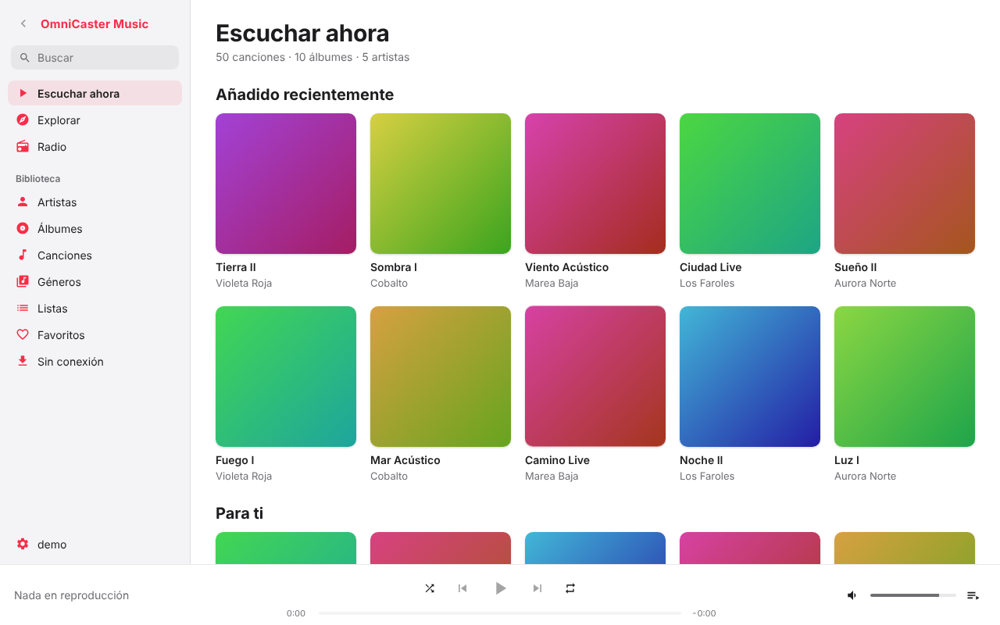
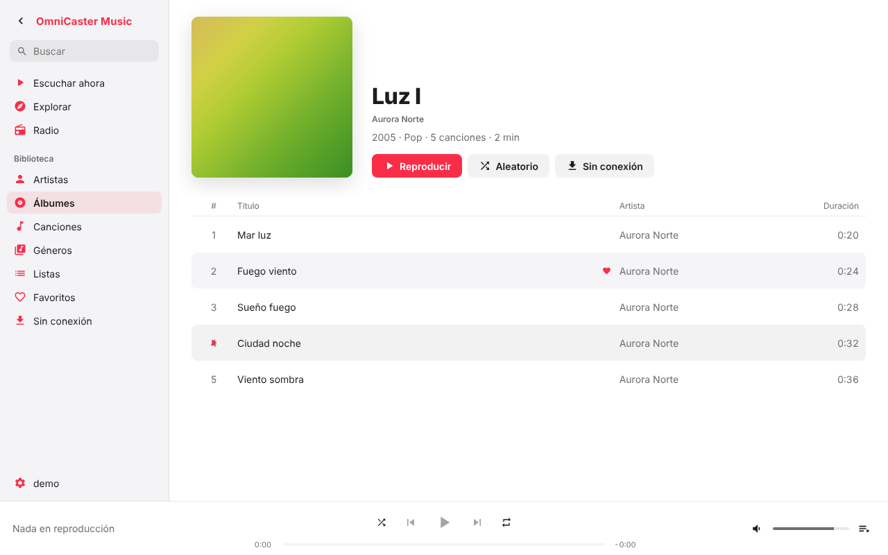
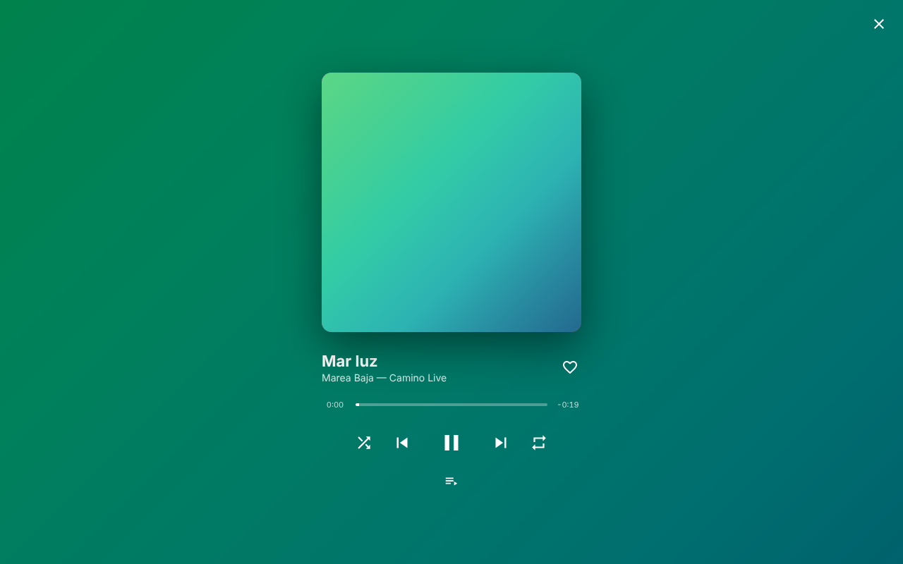
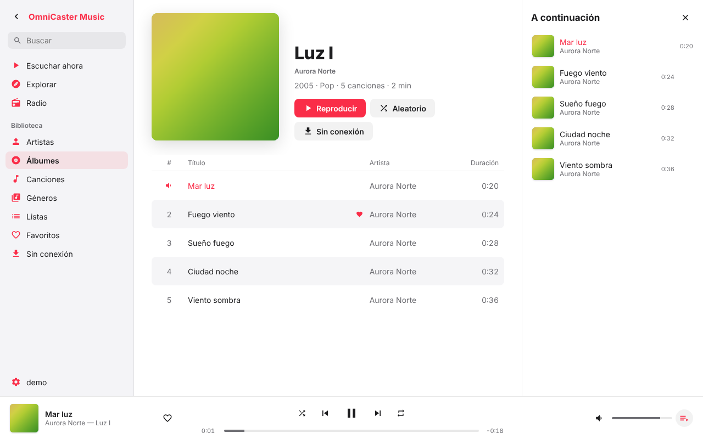
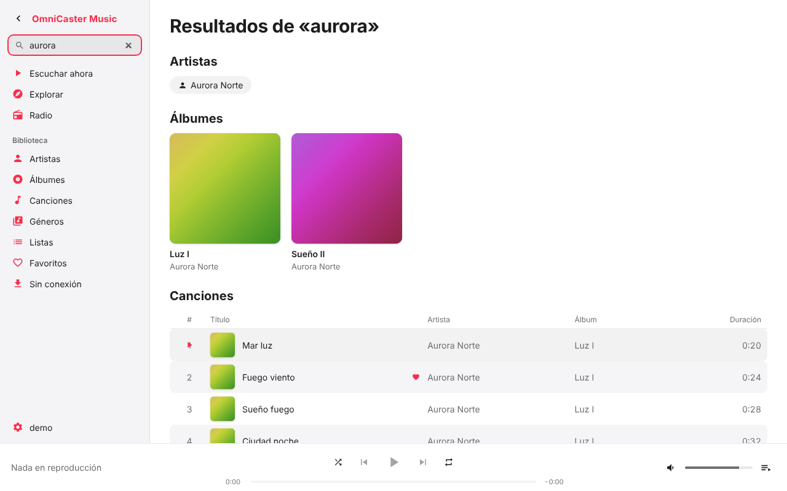
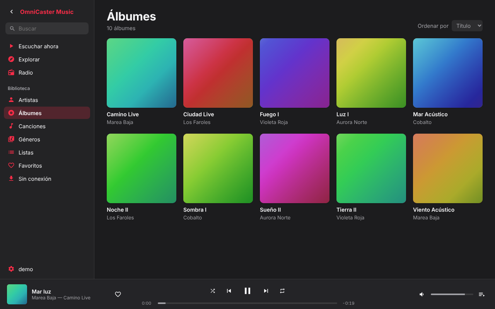
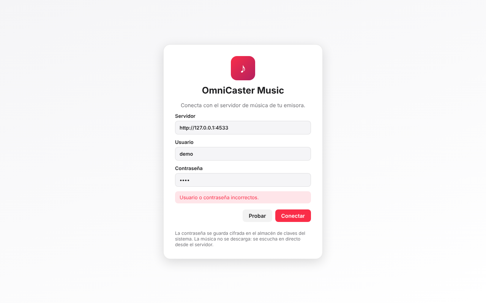

# OmniCaster Music

Reproductor de música de escritorio, al estilo Apple Music, para escuchar la biblioteca de una emisora desde su servidor **Subsonic / OpenSubsonic** (por defecto `https://cloud.ngradio.es`).

La música **no se descarga**: se escucha en directo desde el servidor. Solo se guarda en disco lo que se está reproduciendo (un búfer temporal) y lo que marques para escuchar **sin conexión**.



## Qué hace

- **Biblioteca instantánea**: al conectar se carga el catálogo (álbumes, artistas y canciones) en una base de datos local (SQLite). El arranque es inmediato y la búsqueda funciona sin red; se actualiza en segundo plano.
- **Audio propio en Rust** (no en el WebView): `symphonia` decodifica MP3, FLAC, AAC/M4A, OGG y WAV; `cpal` reproduce.
- **Empieza a sonar enseguida y salta a cualquier punto**: lee por HTTP con peticiones `Range` y un búfer en disco.
- **Sin cortes entre pistas** (gapless): la siguiente pista se prepara antes de que acabe la actual.
- **ReplayGain** si viene en las etiquetas (o en los datos del servidor); si no, no toca el volumen.
- **Controles del sistema**: teclas multimedia, carátula y controles en Windows (SMTC) y Linux (MPRIS).
- **Sin conexión**: guarda álbumes o listas en una carpeta que eliges; indicador de lo descargado y opción de liberar espacio.
- **Favoritos, historial y listas propias** guardados en local (el servidor puede no admitir `star` ni listas; se sincroniza solo lo que acepte).
- **Interfaz**: tema claro/oscuro (sigue al sistema), lista de canciones virtualizada (miles de filas sin tirones), cola reordenable arrastrando, vista «Reproduciendo» a pantalla completa con fondo difuminado de la carátula, radio por género.
- **Actualizaciones automáticas** firmadas desde las Releases de GitHub.

| Álbum | Reproduciendo | Cola |
|---|---|---|
|  |  |  |

| Búsqueda | Tema oscuro | Conexión |
|---|---|---|
|  |  |  |

> Las capturas se generan con las pruebas E2E contra un servidor Subsonic falso (`mock-server/`), con 50 canciones de ejemplo y carátulas generadas.

## Instalar

Descarga el instalador desde la [última Release](https://github.com/matiormx/omnicaster-music/releases/latest):

| Sistema | Archivo |
|---|---|
| Windows | `OmniCaster Music_x.y.z_x64-setup.exe` (instalador en español) o `.msi` |
| Linux | `.AppImage` (portátil: `chmod +x` y ejecutar) o `.deb` (`sudo apt install ./archivo.deb`) |

En Linux hace falta un servicio de audio (PulseAudio/PipeWire/ALSA) y, para guardar la contraseña en el almacén seguro, un servicio *Secret Service* (GNOME Keyring o KWallet). Si no hay, la aplicación avisa y pide la contraseña en cada arranque.

## Conectarse

1. Abre la aplicación. La primera vez aparece la pantalla de conexión, con el servidor `https://cloud.ngradio.es` ya escrito.
2. Escribe tu **usuario** y **contraseña** y pulsa **Probar**: hace un `ping` y te dice si todo va bien.
3. Pulsa **Conectar**. La contraseña se guarda **cifrada en el almacén de claves del sistema** (Windows Credential Manager, Secret Service en Linux); nunca en texto plano.

Errores frecuentes: *«Usuario o contraseña incorrectos»* (error 40 de Subsonic), *«No se puede conectar con el servidor»* (dirección o red).

### Atajos

| Tecla | Acción |
|---|---|
| Espacio | Reproducir / pausa |
| ← → | Retroceder / avanzar 5 s |
| Mayús + ← → | Pista anterior / siguiente |
| ↑ ↓ | Volumen |
| Ctrl + F | Buscar |
| Doble clic en una canción | Reproducirla |
| Clic derecho | Menú: a continuación, cola, ir al álbum/artista, favorito, lista, sin conexión |

## Desarrollo

Requisitos: Rust estable, Node 20+ y, en Linux, `libwebkit2gtk-4.1-dev`, `libasound2-dev`, `libdbus-1-dev`, `libsecret-1-dev`, `libgtk-3-dev`, `libayatana-appindicator3-dev`, `librsvg2-dev`, `libssl-dev`.

```bash
npm install
npm run mock          # servidor Subsonic falso en :4533 (usuario demo / contraseña demo)
npm run tauri dev     # aplicación de escritorio
npm run dev           # solo la interfaz en el navegador (usa un backend web de pruebas)
```

Comprobaciones antes de cada commit:

```bash
cd src-tauri && cargo clippy --all-targets -- -D warnings && cargo test
cd .. && npx tsc --noEmit && npm run build
npx playwright test   # interfaz contra vite dev + servidor falso (necesita Chromium)
```

Estructura:

```
src-tauri/src/subsonic.rs    cliente y parseo tolerante de la API (md5 + sal)
src-tauri/src/rangecache.rs  fuente HTTP con Range y búfer en disco
src-tauri/src/audio.rs       decodificación, remuestreo, gapless, ReplayGain, salida
src-tauri/src/db.rs          SQLite (biblioteca, valores, sin conexión)
src-tauri/src/lib.rs         comandos de Tauri, carátulas, controles multimedia
src/                         interfaz React + TypeScript
mock-server/                 servidor Subsonic falso para desarrollo y tests
```

## Publicar una versión

Las Releases las construye GitHub Actions (`.github/workflows/release.yml`) al subir una etiqueta `v*` (o a mano). Antes de la primera vez, el repo necesita estos secretos:

```bash
gh secret set TAURI_SIGNING_PRIVATE_KEY < clave-privada.key
gh secret set TAURI_SIGNING_PRIVATE_KEY_PASSWORD
```

La clave **pública** ya está en `src-tauri/tauri.conf.json`; la privada no debe subirse nunca al repo.

```bash
git tag v0.1.0 && git push origin v0.1.0
```

## Pendiente

Consulta [`PENDIENTE.md`](PENDIENTE.md) y las decisiones tomadas en [`DECISIONES.md`](DECISIONES.md).
